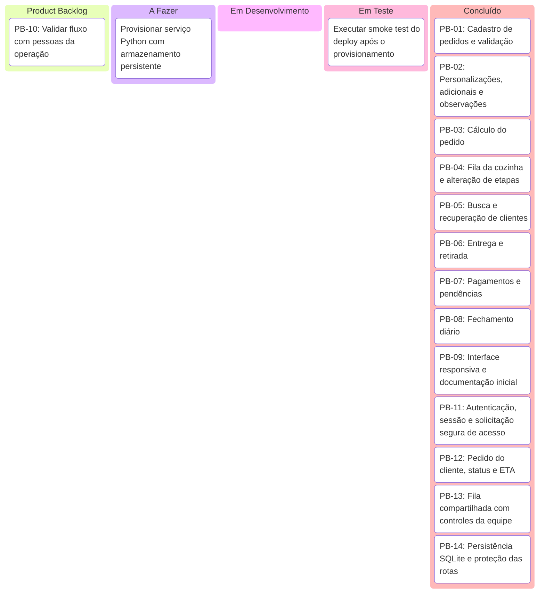

# Quadro Kanban

## Limites de trabalho em andamento (WIP)

| Coluna | Limite |
| --- | --- |
| Product Backlog | Até 14 histórias priorizadas; itens sem prioridade ficam no documento do backlog |
| A Fazer | 3 itens |
| Em Desenvolvimento | 2 itens |
| Em Teste | 2 itens |
| Concluído | Sem limite (não é trabalho em andamento) |

Ao atingir o limite de uma coluna, terminar ou ajudar a desbloquear um cartão antes de puxar outro. Reavaliar esses limites após observar o tamanho real da equipe; não são uma medida de velocidade.

## Quadro atual

**Estado real:** a primeira versão local e a implementação do backend estão em andamento neste repositório; o item de publicação depende do provisionamento de hospedagem Python com disco persistente. Testes automatizados são preparados para CI, mas validação manual em dispositivos e sessões com participantes permanecem pendentes. Não há participantes ou resultados fictícios representados no quadro.
