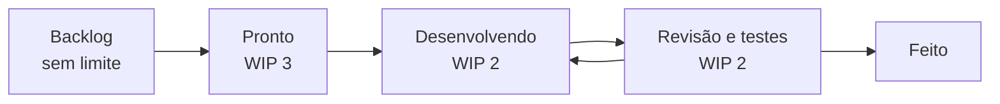

# Planejamento do produto — Marmita em Dia

## Contexto e hipótese de trabalho

**Público:** pequenos restaurantes, marmitarias e estabelecimentos de alimentação que atendem pedidos próprios, sobretudo por WhatsApp. **Pessoa-guia:** Dona Marta, responsável por receber pedidos, repassá-los à cozinha e conferir o caixa.

O fluxo descrito no briefing é a base desta hipótese. As dores abaixo são oportunidades a investigar, não resultados de entrevistas nem afirmações sobre todas as marmitarias.

## Jornada atual, dores a investigar e oportunidades

| Etapa            | Jornada descrita                                       | Dores/risco a investigar                                           | Oportunidade                                                                 |
| ---------------- | ------------------------------------------------------ | ------------------------------------------------------------------ | ---------------------------------------------------------------------------- |
| Chegada          | Cliente manda texto ou áudio pelo WhatsApp             | Mensagens se misturam com conversas; dados podem ficar incompletos | Registrar nome, telefone e canal num pedido estruturado                      |
| Anotação         | Marta transcreve prato, quantidade, ajustes e endereço | Personalizações podem ser esquecidas; endereços se repetem         | Itens com quantidade, adicionais, ajustes e observações; reutilizar cadastro |
| Cozinha          | Pedido é repassado verbalmente ou por mensagem         | Não há visão única do que começou, está pronto ou saiu             | Fila visual por etapa e instruções junto ao prato                            |
| Entrega/retirada | Pedido é entregue ou buscado no balcão                 | Dificuldade de identificar próximos passos e responsável           | Registrar modalidade e avançar até entrega/retirada concluída                |
| Caixa            | Pagamento é conferido separadamente do pedido          | Venda pode ser confundida com valor já recebido                    | Mostrar total vendido, recebido e pendente em indicadores distintos          |

**Oportunidade central:** reduzir retrabalho entre conversa, cozinha e caixa sem obrigar o estabelecimento a trocar seu canal de venda ou adotar um sistema complexo.

## Wireframes textuais

### Visão geral

```text
┌ Marmita em Dia ────────────────┐ ┌ Início / Visão geral ───── Hoje ┐
│ Marmitaria da Marta            │ │ Bom dia, Dona Marta   [+ pedido] │
│ ▸ Visão geral                  │ │ [Em andamento] [Vendas] [Recebido]│
│   Fila da cozinha              │ │ [A receber]                      │
│   Clientes                     │ │ Pedidos em andamento             │
│   Financeiro                   │ │ [#1048 Ana · entrega · R$ 29,90] │
│                                │ │ [#1047 João · preparo · R$ 26,90]│
│                                │ │ Resumo: vendas / recebido / falta│
└────────────────────────────────┘ └───────────────────────────────────┘
```

### Novo pedido

```text
┌ Novo pedido ───────────────────────────────────────────────┐
│ 01 Cliente: [cliente conhecido ▾] [nome] [WhatsApp]        │
│    (●) Entrega  ( ) Retirada   Endereço [rua, número]      │
│ 02 Prato [cardápio ▾] [atalhos de prato]                    │
│    Adicionais [ ] ovo [ ] carne [ ] farofa                  │
│    Ajustes [ ] sem cebola [ ] sem salada   Quantidade [1]  │
│    [Adicionar prato]                                        │
│ 03 Sacola: item + ajustes + adicionais        Total R$ ... │
│    Pagamento [forma ▾] [já recebido] [Salvar pedido]        │
└─────────────────────────────────────────────────────────────┘
```

### Fila da cozinha e financeiro

```text
Fila: [Novos] → [Em preparo] → [Prontos] → [Em entrega]
       pedido       pedido       pedido       pedido

Financeiro:
┌ Vendas registradas ──────────────────────────── R$ 000,00 ┐
│ Recebido R$ 000,00      Pendente R$ 000,00               │
│ Pedido | Cliente | Total | Recebido | Falta | Situação   │
└───────────────────────────────────────────────────────────┘
```

## Testes com usuários

**Status:** roteiro preparado; sessões e resultados ainda não realizados. Não preencher como se fossem entrevistas concluídas. Convidar pelo menos duas pessoas que recebam ou operem pedidos de alimentação; obter consentimento, evitar dados reais de clientes e registrar dificuldades observáveis, não apenas opiniões.

### Pessoa 1 — Dona Marta, responsável por pedidos

**Cenário:** chegou pelo WhatsApp um pedido de uma marmita de frango, sem cebola, com ovo extra, para entrega. Ana já comprou antes.

1. Encontre o cadastro de Ana e confirme telefone/endereço.
2. Crie o pedido com o prato, ajuste, adicional e taxa de entrega.
3. Explique como conferiria o total antes de salvar.
4. Encontre o pedido na fila e marque-o em preparo e depois pronto.

**Observar:** tempo até salvar, erros de preço/endereço, entendimento de adicionais, necessidade de voltar telas, confiança no status.

### Pessoa 2 — apoio de cozinha ou caixa

**Cenário:** há um pedido para retirada já pago, um pedido entregue ainda não pago e um novo pedido com pagamento parcial.

1. Localize os três pedidos e diga qual precisa de ação na cozinha.
2. Marque o pedido para retirada como retirado; conclua a entrega do outro.
3. Consulte vendas, recebimentos e pendências e explique a diferença.
4. Registre o recebimento restante e confira a atualização do saldo.

**Observar:** compreensão das etapas, distinção entre faturado e recebido, receio de registrar pagamento, clareza dos rótulos.

### Registro de resultados (preencher após cada sessão)

| Campo                                                | Registro |
| ---------------------------------------------------- | -------- |
| Identificador/papel, sem dados pessoais              |          |
| Data e consentimento                                 |          |
| Cenário executado                                    |          |
| Tarefa concluída? / tempo aproximado                 |          |
| Erros ou hesitações observáveis                      |          |
| Falas literais relevantes, sem identificar terceiros |          |
| Gravidade (bloqueador / alto / baixo)                |          |
| Aprendizado e hipótese                               |          |
| Alteração proposta / responsável                     |          |
| Revalidado?                                          |          |

## Backlog e critérios de aceite

Critérios descrevem o comportamento deste protótipo e orientam validação; não substituem requisitos legais, de segurança ou operação em produção.

| ID / prioridade           | Item                                               | Critérios de aceite                                                                                                                                                     |
| ------------------------- | -------------------------------------------------- | ----------------------------------------------------------------------------------------------------------------------------------------------------------------------- |
| P1 — Pedido rápido        | Criar pedido a partir da conversa                  | Um pedido requer cliente com telefone válido e ao menos um item. A interface aceita entrega ou retirada, registra observações e adiciona o pedido à fila como novo.     |
| P1 — Total correto        | Calcular pratos, quantidades, adicionais e entrega | Valores são armazenados em centavos; total é a soma de (preço + adicionais) × quantidade mais taxa. Retirada não cobra entrega. Quantidade precisa estar entre 1 e 99.  |
| P1 — Personalização       | Guardar instruções por item                        | O item conserva ajustes, adicionais e observação na sacola, pedido e cartão da cozinha. Cada adicional altera o total.                                                  |
| P1 — Cliente recorrente   | Reusar cadastro                                    | Selecionar telefone conhecido preenche nome e endereço salvo; salvar atualiza cadastro sem duplicar o cliente por telefone.                                             |
| P1 — Fila                 | Avançar status do pedido                           | Novos → preparo → pronto → entrega/retirada; entrega pode passar por “saiu para entrega”. Ações inválidas são recusadas; itens entregues/retirados não avançam de novo. |
| P1 — Persistência local   | Retomar após recarregar                            | Pedidos e clientes ficam no navegador atual. Erros de leitura ou gravação são visíveis; não se sugere sincronização entre dispositivos.                                 |
| P1 — Caixa confiável      | Separar venda de recebimento                       | Vendas somam pedidos não cancelados; recebido soma somente pagamentos registrados; pendente é a diferença. Pagamento negativo, zero ou acima do saldo não é aceito.     |
| P2 — Exportar             | Baixar relatório                                   | CSV contém pedido, data, cliente, status, modalidade, total, recebido e pendente; texto é escapado e valores usam separador decimal brasileiro.                         |
| P2 — Acessibilidade       | Operar sem depender apenas de cor ou mouse         | Controles têm rótulos, foco visível, estados textuais e navegação responsiva. Redução de movimento respeita preferência do navegador.                                   |
| P2 — Validação de produto | Testar com operadores reais                        | Pelo menos duas sessões documentadas no modelo acima; tarefas, problemas e decisões são registrados sem inventar resultados.                                            |

## Plano de duas sprints

Estimativa de planejamento: duas sprints de duas semanas; datas e capacidade precisam ser acordadas pela equipe. As sprints são uma proposta, não um histórico de desenvolvimento.

### Sprint 1 — Pedido à cozinha (2 semanas)

**Objetivo:** registrar o pedido recebido por mensagem e garantir que a cozinha consiga executá-lo.

- Pedido rápido: cliente, entrega/retirada, endereço e taxa.
- Catálogo, quantidade, personalizações, adicionais e observações.
- Cálculo de preço em centavos e validações de entrada.
- Reuso de cadastro/endereço e persistência local.
- Fila por etapa com transições até pronto, entrega ou retirada.
- Testes automatizados de preço, customização, transições e dados inválidos.

**Aceite da sprint:** um pedido válido pode ser criado e localizado na cozinha com total reproduzível; entrada inválida não cria pedido.

### Sprint 2 — Caixa e validação (2 semanas)

**Objetivo:** conferir pagamentos sem confundir venda registrada com dinheiro recebido.

- Registro de pagamento no pedido e saldo em aberto.
- Visão financeira com vendas, recebido e pendente.
- Exclusão de cancelados das vendas e validação de excesso de pagamento.
- Exportação CSV do período disponível.
- Revisão de acessibilidade, layout móvel e mensagens de erro.
- Testes com duas pessoas e priorização dos problemas encontrados.

**Aceite da sprint:** valores do resumo batem com os pedidos individuais; pagamento atualiza recebido e pendente; relatórios exportados preservam os mesmos valores.

## Kanban do time

Limites de trabalho em andamento (WIP) propostos para uma equipe pequena. “Backlog” é ilimitado; limite aplica-se a itens ativos. Ao atingir o limite, terminar/revisar trabalho antes de puxar outro cartão.



**Política de pronto:** objetivo e critérios de aceite compreendidos. **Em desenvolvimento:** implementar só o necessário, atualizar testes e registrar bloqueios. **Revisão/testes:** critérios verificados, regressões e acessibilidade conferidas. **Feito:** critérios aceitos e validações executadas; resultado de pesquisa só pode ser marcado como feito depois de sessões reais.

## Progresso desta versão

- **Implementado no protótipo:** pedidos, catálogo de demonstração, adicionais/ajustes, clientes, fila, caixa, recebimentos, CSV e persistência no navegador.
- **Automatizado:** testes das regras de preço, itens/adicionais, status e resumo financeiro; workflow de CI executa testes e build.
- **Pendente para produção:** backend, contas/permissões, sincronização e backup, integração oficial com WhatsApp, proteção/retensão de dados pessoais e validação real com usuários.
- **Não realizado:** entrevistas, pesquisa de campo, teste moderado, deploy ou histórico de commits apresentado como evidência de sprint.
